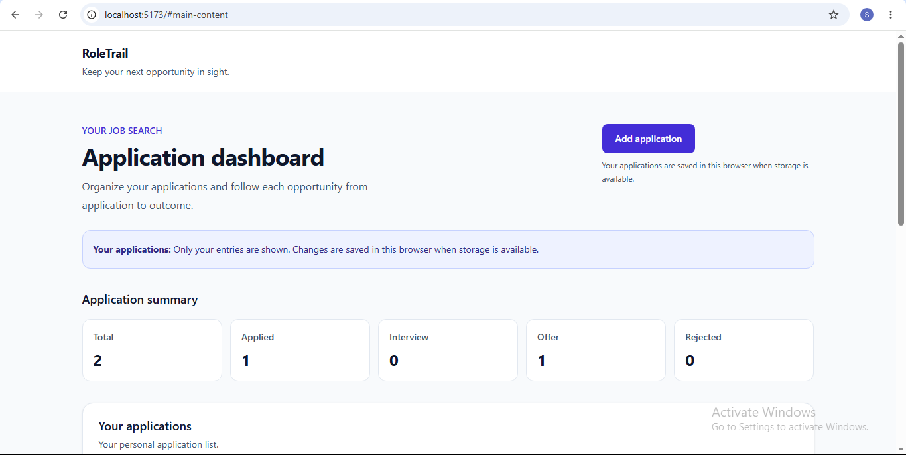
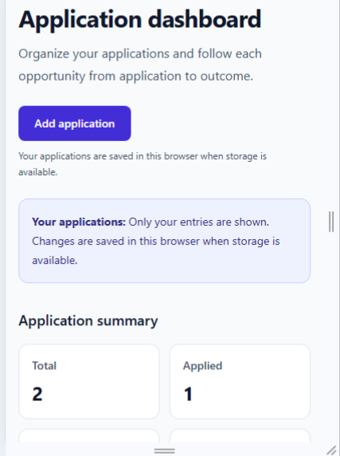

# RoleTrail

## Live demo

[Open RoleTrail](https://my-roletrail.vercel.app/)

A responsive job application tracker built with React and JavaScript.

## Features

- Add applications with company, role, applied date, and status
- Edit applications with prefilled fields and cancel unsaved edits
- Confirm or cancel deletion
- Search by company or role, ignoring case and surrounding spaces
- Combine search with status filtering
- Sort by applied date, newest or oldest first
- View summary counts derived from application records
- Save applications across refreshes using localStorage
- Preserve an empty personal list after deleting the last entry
- Display storage error messages when loading or saving fails
- Responsive layout, labelled inputs, focus styles, and skip navigation

## Demo and personal entries

The dashboard initially displays four labelled fictional demo records.
Demo records cannot be edited or deleted.
Adding your first application replaces the demo records with your personal list.
Personal applications persist in this browser when storage is available.
Deleting every personal application preserves an empty list across refreshes.
Closing and reopening the add form preserves an unfinished add draft.
Saving edits preserves the application's ID; cancelling discards unsaved edits.

## Stack

React, JavaScript, Vite, Tailwind CSS, ESLint, Vitest, React Testing Library, and jsdom.
Development environment: Node.js 22.20.0.

## Run locally

Run these commands in PowerShell:

    git clone https://github.com/samreenmuniza12/job-application-tracker.git
    cd job-application-tracker
    npm.cmd ci
    npm.cmd run dev

Open the exact Local URL printed by Vite.
Keep the server terminal open.

## Quality checks

    npm.cmd test
    npm.cmd run lint
    npm.cmd run build

Watch tests during development:

    npm.cmd run test:watch

Preview the production build:

    npm.cmd run build
    npm.cmd run preview

All 15 automated tests pass. They cover:
- Storage round trips, missing data, and saved empty lists
- Malformed JSON, invalid record structures, and unsupported statuses
- Storage read and write failures
- Adding applications, demo replacement, and restoring saved entries
- Editing without changing IDs or creating duplicates
- Cancelling and confirming deletion
- Combined search and status filtering, including no-match recovery
- Date sorting without modifying stored records

Lint and production build pass.
Manual keyboard, form validation, and mobile layout checks passed.

## Data and limitations

Applications are stored in localStorage for the current browser and site origin.
There is no backend, authentication, or cross-device synchronization.
Clearing site data removes saved applications.
When saving fails, changes may be lost on refresh.
Storage validation checks record structure and supported statuses.
It does not comprehensively validate every stored field value.
Form validation is separate from storage validation.

## Project structure

- src/components/ui: shared UI components
- src/components/layout: layout components
- src/components/applications: form, cards, list, and summary
- src/data: fictional sample records
- src/pages: dashboard and behavior tests
- src/services: storage functions and tests
- src/test: shared test setup

## Git workflow

main -> dev -> feature/* or fix/*

Create feature or fix branches from dev.
Merge them into dev through pull requests.
Merge verified releases from dev into main through pull requests.
Use Create a merge commit.

## Learning approach

Built module by module with AI-assisted guidance and code review.

## Screenshots

### Desktop

### Mobile

